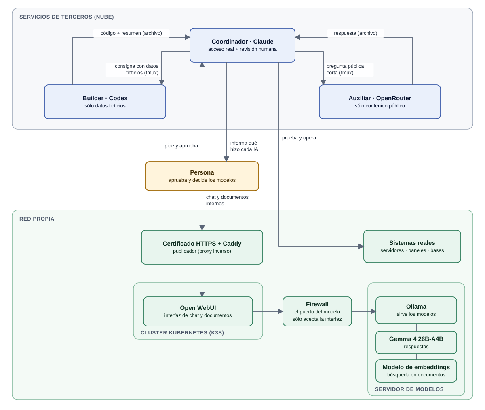

# AI Operations Lab

**Three AI assistants and a self-hosted model working together on self-hosted infrastructure, with a human making the calls.**
A delegation workflow between Claude, Codex and OpenRouter/OpenCode: who does what, how tasks are requested,
what is not delegated, and what happened when things failed.

Author: Mariano Araujo · MIT license · Spanish is the primary language of this repository.

## In one minute

1. **Problem:** a single assistant runs out of quota and mixes tasks of different risk; with several and no rules,
   sensitive data ends up in the wrong place.
2. **Decision:** split work by **data risk**, not by difficulty. Sensitive work stays with the coordinator, which has real
   access and human review; code goes to a builder that only sees fictional data; short public questions go to an economical model.
3. **What I implemented:** the role and data rules, an example router with tests, a `tmux` delegation script with tests,
   and a self-hosted model setup. The AI assistants wrote and tested a large part of the code.
4. **Verify in a minute:**
   ```bash
   python3 -m unittest discover -s tests -v   # 11 router tests
   bash tests/test_delegate.sh                # 5 script cases, with a simulated tmux
   ```



## What it shows

- **Roles split by data risk:** the coordinator keeps anything sensitive or unclassified; the builder handles code with fictional data; the auxiliary model answers short public questions.
- **Delegation through `tmux` sessions:** answers are read from files, with an explicit end marker. The screen is only used for two heuristic signals (idle input box, permission prompt).
- **A self-hosted model** (Ollama behind Open WebUI on Kubernetes, published over HTTPS through Caddy) for short tasks on internal documents without sending data out.
- **Documented failures and fixes** in [`docs/decisions.md`](docs/decisions.md).

## What this repository does and does not guarantee

- **Does:** the split rules are written down, the example router follows them in the tested cases, and the delegation script handles its test cases (busy, permission prompt, timeout, complete answer).
- **Does not:** guarantee that no sensitive data ever leaves. The coordinator and the other assistants are third-party services; separation depends on **procedures** (what goes into each prompt, human review), not on code. Only the self-hosted model processes data without sending it outside the network.

## Models and local model

Model choice follows the type of work (an economical default, a stronger model only when needed). On OpenRouter, free and
pay-per-use models were compared and the cheapest fast one among those tested was chosen. A local model was selected by
measuring five models on an Intel i5 / 32 GB / no-GPU machine. Details (Spanish): [`docs/models.md`](docs/models.md),
[`docs/local-model.md`](docs/local-model.md).

## Skills policy

Official skills are preferred. A custom skill is built only for a specific, concrete use and documented. Installing
third-party skills is avoided; it is done only after an exhaustive review.

## Try it

See [`docs/getting-started.md`](docs/getting-started.md). Limits (what this does *not* prove): [`docs/limitations.md`](docs/limitations.md).
