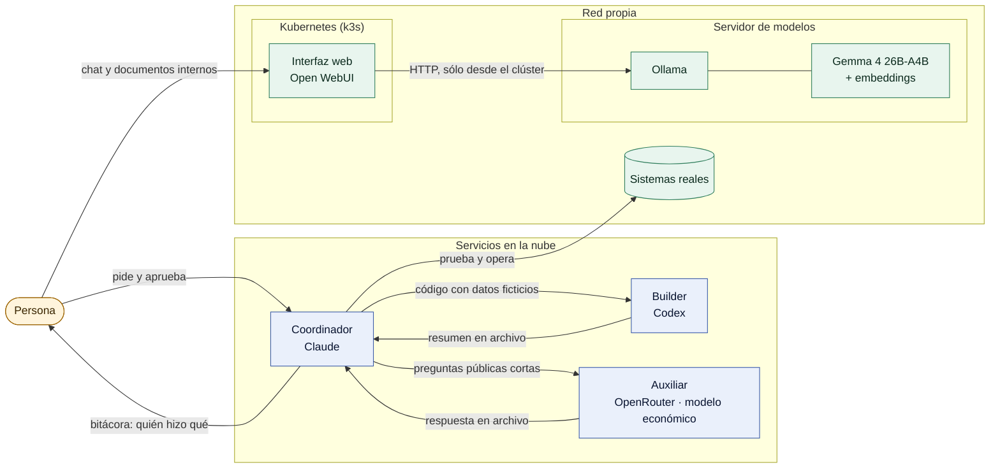

# AI Operations Lab

**Tres asistentes de IA y un modelo propio trabajando juntos sobre infraestructura propia, con una persona que decide.**
Un esquema de delegación entre Claude, Codex y OpenRouter/OpenCode: quién hace qué, cómo se piden las tareas,
qué no se delega y qué pasó cuando algo falló.

[English summary](README.en.md) · Autor: Mariano Araujo · Licencia MIT

## En un minuto

1. **Problema:** un solo asistente se queda sin cupo y mezcla tareas de riesgo distinto; con varios y sin reglas, los
   datos sensibles terminan en el lugar equivocado.
2. **Decisión:** repartir por **riesgo del dato**, no por dificultad. Lo sensible queda con quien tiene el acceso real y la
   revisión humana; el código se delega con datos ficticios; lo público y corto va a un modelo económico.
3. **Qué implementé:** el diseño de roles y reglas, un enrutador de ejemplo con pruebas, un script de delegación por
   `tmux` con pruebas, y la configuración de un modelo propio. Las IA escribieron y probaron buena parte del código.
4. **Cómo verificarlo en un minuto:**
   ```bash
   python3 -m unittest discover -s tests -v   # 11 pruebas del enrutador
   bash tests/test_delegate.sh                # 5 casos del script, con un tmux simulado
   ```

## Los participantes

| Participante | Rol | Recibe (por regla) | No recibe (por regla) |
|---|---|---|---|
| **Coordinador** (Claude) | Coordina, revisa, prueba y publica; opera con acceso real | Todo lo sensible o sin clasificar | — |
| **Builder** (Codex) | Escribe código y pruebas | Consignas con datos **ficticios** | Credenciales, datos reales |
| **Auxiliar** (OpenRouter/OpenCode, modelo económico) | Preguntas cortas y segunda opinión | Sólo contenido público | Cualquier dato que identifique a alguien |
| **Modelo propio** (Ollama + Open WebUI) | Tareas cortas con documentos internos, sin enviar nada afuera | Documentos sin datos sensibles | — |

Una persona aprueba lo que sale hacia afuera y decide los cambios de modelo.



## Qué incluye

- [`src/route.py`](src/route.py): enrutador de ejemplo y [sus pruebas](tests/test_route.py). **Recomienda** un destino; no detecta secretos ni pide aprobaciones.
- [`src/delegate.sh`](src/delegate.sh) y [sus pruebas](tests/test_delegate.sh): enviar un pedido a un asistente en una sesión `tmux` y esperar su respuesta en un archivo.
- [`docs/`](docs/): [arquitectura](docs/architecture.md), [modelos](docs/models.md), [modelo propio](docs/local-model.md), [ejemplo de ejecución](docs/execution-example.md), [decisiones](docs/decisions.md), [cómo probarlo](docs/getting-started.md) y [límites](docs/limitations.md).

## Qué garantiza este repositorio y qué no

- **Sí:** que las reglas de reparto están escritas, que el enrutador de ejemplo las cumple en los casos probados y que el
  script de delegación responde a los casos de prueba (ocupado, permiso, tiempo agotado, respuesta completa).
- **No:** que ningún dato sensible salga nunca. El coordinador y los otros asistentes son servicios de terceros; la
  separación depende de **procedimientos** (qué se escribe en cada consigna, revisión humana) y no del código. Sólo el
  modelo propio procesa sin enviar datos fuera de la red.

## Modelos

El modelo se ajusta al uso: uno optimizado para las tareas del día y uno más alto sólo cuando lo exige la complejidad o
la habilidad necesaria, para Claude, Codex y OpenRouter. En OpenRouter se compararon modelos gratuitos y de pago, se
calculó el costo por consulta y se eligió el más barato y rápido de los probados para preguntas cortas.
Detalle y método en [`docs/models.md`](docs/models.md).

## Modelo propio

Corre en un equipo con CPU Intel i5 y 32 GB de RAM, sin GPU. Se midió la velocidad de cinco modelos y se eligió
Gemma 4 26B-A4B (de 7 a 11 tokens por segundo). Está pensado para tareas cortas con documentos internos; no es para
razonamiento exigente. Mediciones, usos y límites en [`docs/local-model.md`](docs/local-model.md).

## Skills

Se prefieren las skills oficiales de cada herramienta. Una skill propia se construye sólo para un uso puntual y se
documenta (qué hace y por qué no alcanzaba una oficial). Se evita instalar skills de terceros; sólo se hace luego de un
control exhaustivo.

## Mi aporte y el de las IA

- **Mío:** el diseño de roles y reglas de datos, qué se delega, la aprobación de todo lo que se publica, la elección de
  modelos y los límites de consumo.
- **De las IA:** escribir y probar buena parte del código, investigar y proponer alternativas. Cada tarea deja registro.

## Límites

Es un caso técnico con una muestra pequeña. No incluye el sistema completo, no mide productividad y no demuestra que el
esquema sirva para otros equipos. Detalles en [`docs/limitations.md`](docs/limitations.md).
