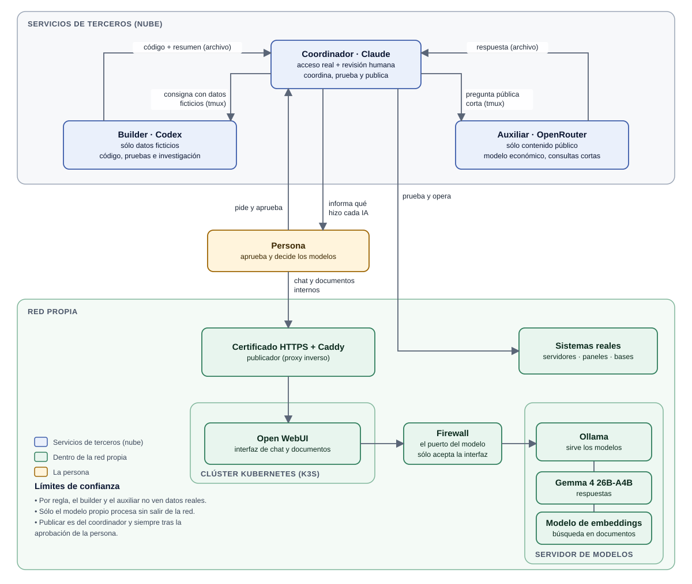
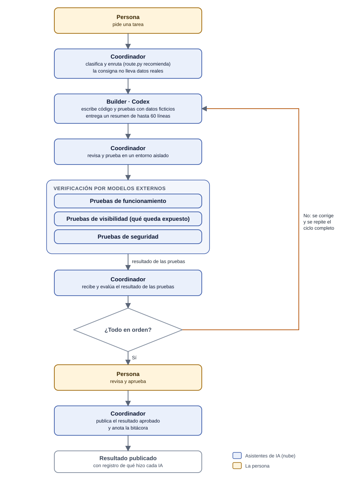

# Arquitectura

## Diagrama general

*Versión en alta resolución: [`02-arquitectura.png`](assets/02-arquitectura.png)*

## Piezas

1. **Coordinador.** Lo usa la persona todos los días. Tiene acceso a los sistemas reales. Por regla, es el único que
   toca credenciales, finanzas, datos personales o infraestructura de producción. Es un servicio de terceros: "acceso
   real" no significa que lo que procesa se quede en la red propia.
2. **Builder.** Corre en su propia sesión `tmux`. Recibe consignas con datos inventados y devuelve código y un resumen
   de hasta 60 líneas.
3. **Auxiliar.** Otra sesión `tmux` con un modelo económico. Sólo preguntas públicas y cortas.
4. **Modelo propio.** Ollama sirve el modelo dentro de la red; Open WebUI, desplegado en Kubernetes, es el frente de
   chat y de consulta de documentos, publicado con un certificado HTTPS a través de Caddy (proxy inverso). Es el único
   camino donde el contenido no sale de la red.
5. **Verificación por modelos externos.** Antes de pedir la aprobación, otros modelos hacen pruebas de funcionamiento,
   de visibilidad y de seguridad sobre lo entregado y devuelven el resultado al coordinador.
6. **Persona.** Mira cualquier sesión en vivo, aprueba lo que se publica y es la única que cambia el modelo de un asistente.

## Flujo de una tarea

Después de que el builder entrega y el coordinador revisa, **modelos externos hacen una verificación aparte**: pruebas de
funcionamiento, de visibilidad (qué queda expuesto) y de seguridad. El resultado vuelve al coordinador; si algo falla, se
corrige y se repite el ciclo completo. Sólo con todo en orden se le pide la aprobación a la persona, y recién entonces se publica.

*Versión en alta resolución: [`03-flujo-de-una-tarea.png`](assets/03-flujo-de-una-tarea.png)*

## Límites de confianza

- Por regla, el builder y el auxiliar no ven credenciales ni datos reales. Esa regla se cumple con procedimiento
  (cómo se escribe cada consigna y la revisión humana); `route.py` sólo recomienda un destino.
- Los modelos gratuitos pueden conservar lo que reciben: por eso sólo reciben contenido público.
- Publicar es una acción del coordinador, siempre después de que la persona aprueba.

## Por qué archivos y no la pantalla

Una sesión de terminal corta los textos largos. Se le pide al asistente que escriba la respuesta completa en un
archivo que termina con una marca explícita (`<<FIN>>`) y se lee ese archivo. La pantalla se consulta sólo para dos
señales heurísticas: si la caja de entrada está libre y si hay un pedido de permiso.
