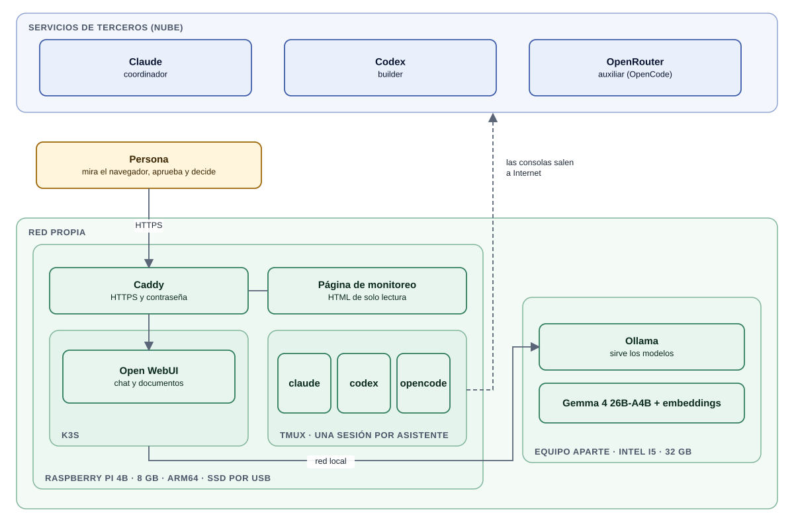

# Hardware objetivo: todo en una Raspberry Pi 4B de 8 GB

El diseño apunta a que **todo el laboratorio entre en una sola placa** y a que desde ahí se lancen los procesamientos.
Lo único que corre aparte es el modelo propio, que necesita más memoria y CPU que una Raspberry.

*Versión en alta resolución: [`05-hardware-unico.png`](assets/05-hardware-unico.png)*

## Qué corre dónde

| Equipo | Qué corre | Por qué ahí |
|---|---|---|
| **Raspberry Pi 4B, 8 GB** (ARM64) | Las tres consolas en `tmux` (Claude Code, Codex, OpenCode), Caddy (HTTPS), k3s con Open WebUI y la página de monitoreo | Son piezas livianas: los modelos de los asistentes corren en la nube y la placa sólo ejecuta las herramientas de línea de comandos y los servicios de apoyo |
| **Equipo aparte** (Intel i5, 32 GB, sin GPU) | Ollama con Gemma 4 26B-A4B y el modelo de embeddings | Un modelo de ese tamaño no entra en 8 GB; ver [`local-model.md`](local-model.md) |

Los dos equipos están en la misma red local. Open WebUI (en la Raspberry) habla con Ollama (en el otro equipo) por la
red, y un firewall deja pasar ese puerto sólo desde la Raspberry.

## Presupuesto de memoria (estimado)

Son **estimaciones de diseño, no mediciones** hechas con todo junto en una sola placa. Hay que medirlo en el equipo
real antes de darlo por bueno (ver [`limitations.md`](limitations.md)). Requisito de disco en [`install.md`](install.md).

| Pieza | Memoria estimada |
|---|---|
| Sistema operativo y servicios base | 0,3 a 0,5 GB |
| k3s (servidor de Kubernetes) | 0,5 a 1 GB |
| Open WebUI (límite fijado en el manifiesto: 1,5 GB) | 0,5 a 1,5 GB |
| Caddy | menos de 0,1 GB |
| Tres consolas de IA (herramientas Node.js) | 0,5 a 1,5 GB |
| Página de monitoreo | despreciable (un script cada 30 s) |
| **Total estimado** | **2 a 4,5 GB de 8 GB** |

La holgura es para picos (una consola leyendo un repositorio grande, Open WebUI procesando un documento). Si el uso real
se acerca al límite, lo primero que se mueve fuera de la placa es Open WebUI.

## Recomendaciones de hardware

- **Disco SSD por USB 3** para el sistema y los datos en vez de una tarjeta SD: k3s y las bitácoras escriben mucho y las
  tarjetas se desgastan.
- **Refrigeración** pasiva o activa y una fuente oficial de 5 V / 3 A: bajo carga sostenida la placa se limita por temperatura.
- **Cable de red** en vez de WiFi, para la conexión con el equipo del modelo propio y para llegar a la nube sin cortes.
- **Sistema de 64 bits** (arm64), imprescindible para k3s y las herramientas de línea de comandos.

## Convivencia en una sola placa

- Cada asistente corre con **su propio usuario de Linux** cuando se puede: el builder y el auxiliar no deben poder leer
  los archivos ni las credenciales del coordinador (ver [`architecture.md`](architecture.md)).
- Open WebUI sólo escucha en la propia máquina (NodePort detrás de Caddy); Ollama no se publica nunca a Internet.
- La página de monitoreo es estática y de sólo lectura; Caddy la sirve con contraseña (ver [`monitoring.md`](monitoring.md)).
- Una sola placa es **un solo punto de falla** y concentra las credenciales de las tres herramientas. Se mitiga con
  copias de seguridad cifradas y con la separación de usuarios, no se elimina.
