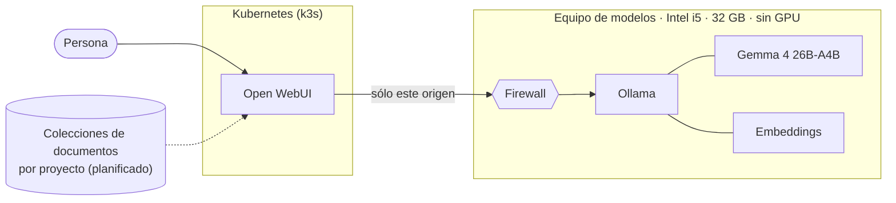

# Modelo propio

Un participante que corre **dentro de la red propia**: lo que se le pregunta no se envía a ningún proveedor.

## Equipo y componentes

- CPU Intel i5, **32 GB de RAM**, sin GPU dedicada, disco NVMe de 1 TB.
- Ubuntu Server 24.04 LTS, **Ollama** (0.40.x) como servidor de modelos.
- **Open WebUI** desplegado en un clúster **Kubernetes (k3s)** como interfaz de chat y de consulta de documentos.
- Discos separados por función (modelos, datos de proyectos, contenedores) con LVM para crecer sin reinstalar.
- Pendiente de registrar: cuantización exacta de cada modelo y versiones de cada componente.

## Para qué se usa

| Uso | Estado |
|---|---|
| Responder, resumir y reescribir textos cortos | Probado a mano; la velocidad está medida |
| Asistentes por proyecto que consultan documentos propios (RAG) | Planificado |
| Trabajo con documentos internos sin que salgan de la red | Motivo principal del modelo propio |
| Razonamiento largo o código complejo | No evaluado y fuera de su función |

La razón de tenerlo es la privacidad y no pagar por consulta (el costo real es el equipo y la electricidad), no competir
en calidad con los modelos de la nube.

## Cómo se eligió

1. **Investigación previa.** Se derivó a Codex una investigación con fuentes. Recomendó arrancar con modelos chicos
   (4B) porque los grandes ocupan mucha RAM; los de tipo MoE guardan todos sus expertos en memoria.
2. **Medición propia, en este equipo.** Cinco modelos, sin "pensar" largo y con contexto de 8.192 tokens, una pasada cada
   uno (sin repeticiones estadísticas):

| Modelo | Tamaño | Velocidad al generar | Carga en frío | Resultado |
|---|---|---|---|---|
| Qwen 3.5 4B | chico | ~9 tokens/s | 4 a 7 s | Rápido; errores con nombres propios |
| Qwen 3.5 9B | mediano | ~4,5 tokens/s | 4 a 7 s | En las pruebas informales, mejor español; más lento |
| Qwen 2.5 Coder 7B | mediano | ~5 tokens/s | 4 a 7 s | No superó a los generales en código simple |
| **Gemma 4 26B-A4B (MoE)** | grande, ~18 GB | **7 a 11 tokens/s** | 51 s | **Acertó el caso de diagnóstico** |
| Qwen 3.5 27B (denso) | grande | ~1,3 tokens/s | 41 s | No acertó del todo; 5 a 8 veces más lento |

3. **Selección.** Gemma 4 26B-A4B. Un modelo MoE activa sólo una parte de los parámetros por token, lo que es una
   explicación probable de que sea más rápido que el denso de tamaño parecido; no se aisló esa causa. Fue el único que
   resolvió el caso de calidad. Los demás se borraron.
4. **Embeddings:** un modelo pequeño para la búsqueda en documentos.

## Nivel de respuesta

- **Velocidad:** 7 a 11 tokens por segundo es lectura cómoda para chat y suficiente para resúmenes cortos; no es ágil
  con textos largos. La primera consulta tras un rato de inactividad tarda cerca de un minuto por la carga.
- **Calidad:** la evaluación fue un **único caso real de diagnóstico** (un script programado que no reinicia un
  servicio de usuario por faltar variables de entorno). Es una muestra mínima: indica capacidad, no prueba fiabilidad.
  No hay una batería de pruebas de resumen, clasificación ni reescritura.
- **Conclusión:** razonable para tareas cortas con documentos internos. No se evaluó para razonamiento exigente.

## Qué se hizo con él

- Instalación y ajuste del servidor de modelos: una conversación en paralelo, el modelo se descarga de memoria a los
  5 minutos sin uso y contexto de 8.192 tokens.
- Firewall: SSH abierto y el puerto del modelo **sólo para el equipo que corre la interfaz web**.
- Interfaz web con las funciones innecesarias apagadas (ejecución de código, memorias, compartir con la comunidad,
  telemetría) y el modelo elegido como predeterminado.
- Medición comparativa de cinco modelos y limpieza de los que no ganaron.

## Próximos pasos

Colecciones de documentos por proyecto (sin datos sensibles), un asistente por proyecto, una prueba con 10 preguntas
reales, recarga semanal de documentos, pasar el equipo a red por cable y registrar versiones y cuantizaciones.
